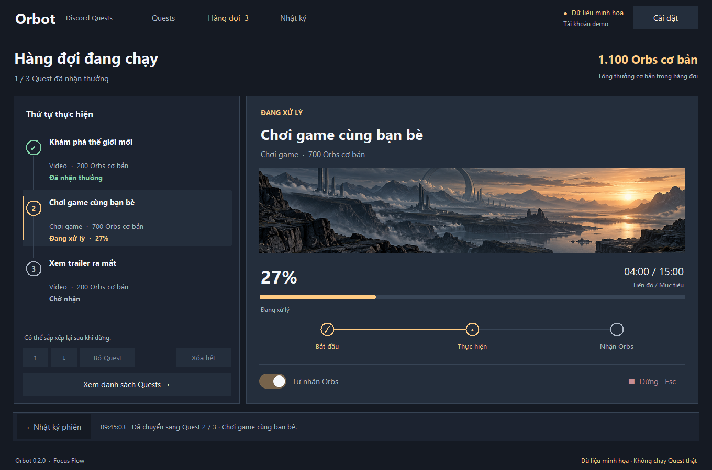

# Orbot 0.2.1 · Focus Flow

Ứng dụng Windows có giao diện tiếng Việt để điều phối Discord Quests thưởng Orbs. Kết nối với Discord Desktop trên máy bằng phiên đã đăng nhập; không yêu cầu nhập token hay mật khẩu.

## Tải xuống

Mở **[bản phát hành mới nhất](https://github.com/hiimkuroshi/Orbot/releases/latest)** và chọn một trong hai file. Không cần cài Python hoặc Node.

- **`Orbot-<phiên bản>-windows-x64.zip`** (khuyên dùng): giải nén rồi mở `Orbot.exe` trong thư mục vừa giải nén. Dạng thư mục khởi động nhanh hơn và ít bị phần mềm diệt virus báo nhầm hơn.
- **`Orbot-<phiên bản>.exe`**: một file duy nhất, mở trực tiếp.

Từ bản 0.2.1, file được build trên GitHub Actions từ mã nguồn công khai, kèm `SHA256SUMS.txt` và chứng nhận nguồn gốc (attestation) của GitHub.

### Khi Windows báo "Windows đã bảo vệ máy tính của bạn"

Đây là SmartScreen, không phải phát hiện virus. SmartScreen cảnh báo mọi file **chưa ký số** và **còn ít lượt tải**; mỗi bản phát hành mới phải tích lũy uy tín lại từ đầu. Kiểm tra file trước, rồi chọn **Thông tin thêm → Vẫn chạy**:

```powershell
Get-FileHash .\Orbot-0.2.1-windows-x64.zip -Algorithm SHA256
gh attestation verify .\Orbot-0.2.1-windows-x64.zip -R hiimkuroshi/Orbot
```

Mã băm phải trùng với dòng tương ứng trong `SHA256SUMS.txt`. Lệnh `gh attestation verify` (cần [GitHub CLI](https://cli.github.com/)) xác nhận file được build bởi workflow của repo này. Không chạy file tải từ nơi khác.

## Chạy ứng dụng

Đóng Orbot cũ, mở `Orbot.exe` từ bản ZIP, hoặc bấm đúp **`Start-Orbot.cmd`** trong thư mục dự án. File EXE đã đóng gói Python và thư viện; máy chạy không cần cài Python hoặc Node. Nếu Discord đã bật cổng kết nối từ lần trước, chỉ cần kết nối, không cần mở lại Discord.

1. Lưu việc đang làm và thoát Discord từ biểu tượng ở khay hệ thống.
2. Mở Orbot, bấm **Kết nối Discord** (hoặc **Cài đặt**) ở góc trên, rồi bấm **Mở Discord**. Orbot tự chọn một cổng ngẫu nhiên và nhớ cổng này cho lần kết nối sau; chỉ nhập cổng khi muốn dùng cổng riêng. Nếu không tìm thấy bản cài, chọn `Discord.exe` khi hộp thoại xuất hiện.
3. Khi Discord mở xong, bấm **Kết nối** trong hộp cài đặt. Khi cần, Orbot mở Quest Home và tải lại giao diện một lần để nạp bộ kết nối. Kết nối xong có thể đóng hộp cài đặt.
4. Kiểm tra tên tài khoản ở góc trên. Ở tab **Quests**, giữ Ctrl/Shift để chọn nhiều hoặc bấm **Chọn tất cả có thể chạy**, rồi **Thêm vào hàng đợi →**.
5. Mục **Hàng đợi** hiển thị thứ tự bên trái và tiến độ Quest bên phải. Có thể đưa lên/xuống, **Bỏ Quest** đã chọn hoặc **Xóa hết** trước khi chạy. Giữ **Tự nhận Orbs** bật (mặc định), rồi bấm **Chạy hàng đợi**.
6. Bấm **Dừng**, nhấn Esc, ngắt kết nối hoặc đóng Orbot để dừng hàng đợi. **Dùng xong, thoát Discord ở khay hệ thống rồi mở lại như bình thường** để đóng cổng gỡ lỗi (xem [Bảo mật](#bảo-mật)). Nếu cổng còn mở khi đóng Orbot, ứng dụng sẽ nhắc lại bước này.

Nếu Discord đã chạy trước khi bấm Mở Discord, phiên hiện tại có thể không nhận cổng mới. Orbot không tự đóng Discord; hãy thoát ở khay hệ thống rồi mở lại từ Orbot. Giữ cửa sổ Orbot mở trong lúc chạy.

## Giao diện Focus Flow

- Nền slate tối, điểm nhấn amber, điều hướng ngang: **Quests**, **Hàng đợi**, **Nhật ký**.
- Hàng đợi có số thứ tự, chọn nhiều bằng Ctrl/Shift; Alt+↑/↓ để đổi thứ tự, Delete để bỏ mục đã chọn. Không chỉnh sửa khi đang chạy.
- Vùng trọng tâm hiển thị tên Quest, thưởng cơ bản, thời gian, tiến độ và ba bước: bắt đầu, thực hiện, nhận Orbs. Chọn mục khác khi đang chạy vẫn giữ Quest đang xử lý ở vùng trọng tâm.
- Nút **Dừng · Esc** vẫn có mặt khi chuyển sang Quests hoặc Nhật ký. Nhật ký mặc định chỉ hiện thông báo gần nhất; bấm để mở toàn bộ và lưu ra file.
- Cửa sổ mặc định 1360×900, tối thiểu 1040×740. Khi thiếu chiều cao, ẩn banner trang trí để giữ các nút thao tác trong khung.
- Banner là hình minh họa đi kèm ứng dụng, không phải ảnh của Quest. Chế độ `--demo` được gắn nhãn và không chạy Quest thật.



## Phạm vi

- Quét các Quest hiện có và chỉ hiển thị Quest có thưởng Orbs.
- Hỗ trợ `WATCH_VIDEO`, `WATCH_VIDEO_ON_MOBILE`, `PLAY_ON_DESKTOP`, `PLAY_ON_DESKTOP_V2`, với cấu hình Quest cũ và `taskConfigV2`.
- Chạy tuần tự, tự nhận Quest chưa đăng ký, hiển thị tiến độ và nhận thưởng theo tùy chọn.
- Danh sách hàng đợi độc lập với dòng đang chọn và bộ lọc. Hoàn thành/nhận thưởng Quest trước rồi tự chuyển sang Quest sau; không cần bấm chạy lại sau mỗi Quest.
- Quest đã hoàn thành chỉ cần bước nhận thưởng. Lỗi riêng của một Quest hoặc lỗi nhận thưởng thông thường được ghi lại rồi chuyển Quest tiếp theo. Hàng đợi bị dừng do xác thực/hạn chế tài khoản giữ nguyên các mục còn chờ; nhật ký cho biết nguyên nhân. Bấm chạy lại chỉ xử lý các mục chưa hoàn thành/nhận thưởng theo tùy chọn hiện tại.
- Video báo tiến độ theo thời gian thực. Game dùng trạng thái nhận diện của Discord và heartbeat do Discord gửi.
- Phân biệt hoàn thành, đã nhận thưởng, lỗi, chưa hỗ trợ và đã dừng. Mốc tiến độ video tự báo không được tính là xác nhận hoàn thành.
- Hỗ trợ dừng, giới hạn thời gian chờ, chờ khi HTTP 429, ngừng khi HTTP 401/403 hoặc cần xác minh, và khôi phục các hàm nhận diện game.
- Không xử lý Quest chỉ dành cho console, stream, thành tích trong game hoặc Activity. Không tạo Quest mới, thay đổi điều kiện khu vực hay chi tiêu Orbs.
- Cột thưởng là **Orbs cơ bản** từ cấu hình Quest, không phải số dư hoặc cam kết số Orbs sẽ được ghi có sau các ưu đãi tài khoản.

## Kết nối và dữ liệu

Python chỉ kết nối tới CDP trên `127.0.0.1`, với cửa sổ thuộc tên miền Discord được xác định. Mã JavaScript chạy trong Discord dùng API client sẵn có của phiên. Không có backend, telemetry, tự đọc token, hoặc lưu thông tin đăng nhập.

Một số bản Discord không còn cho đọc bộ nhớ module sau khi khởi động. Bộ kết nối có thể thu thập **tham chiếu module trong bộ nhớ của chính Discord** khi tải lại, rồi tìm các store theo phương thức. Orbot chỉ nhận tên/ID tài khoản, thông tin Quest, trạng thái và nhật ký qua kết nối cục bộ. Khi đóng Orbot bình thường, bộ xử lý và preload được gỡ; nếu mất liên lạc, watchdog dừng hàng đợi sau khoảng 15 giây khi bộ hẹn giờ của Discord hoạt động.

Trong lúc xử lý game, Discord có thể hiển thị trạng thái chơi game tương ứng. Orbot không thay đổi cài đặt hiển thị hoạt động của tài khoản.

## Bảo mật

Để điều khiển Discord, Orbot mở Discord với **cổng gỡ lỗi** (Chrome DevTools Protocol) trên `127.0.0.1`. Cổng này không có mật khẩu: trong lúc nó mở, **bất kỳ chương trình nào trên máy**, kể cả của tài khoản Windows khác, đều có thể điều khiển Discord đang đăng nhập (đọc token, gửi tin nhắn). Trang web thì bị Discord/Chromium chặn. Cổng chỉ đóng khi Discord thoát hẳn; đóng Orbot không đóng cổng.

Orbot giảm rủi ro bằng cách:

- Chọn cổng ngẫu nhiên thay vì cổng quen thuộc `9222` mà các công cụ dò quét thường thử.
- Trên Windows, kiểm tra chương trình đang giữ cổng là `Discord.exe` (hoặc bản Canary/PTB) trước khi kết nối; từ chối nếu là chương trình khác hoặc không xác minh được.
- Hiển thị cảnh báo trong hộp kết nối, ghi chú "Cổng gỡ lỗi đang mở" ở chân trang khi đã kết nối, và nhắc thoát Discord khi đóng Orbot.

Chỉ dùng Orbot trên máy bạn tin tưởng, và thoát Discord sau khi dùng xong. Kiểm tra chương trình giữ cổng chỉ dựa trên tên file, không chống được phần mềm độc hại đã chạy trên máy. Báo lỗ hổng theo [SECURITY.md](SECURITY.md).

## Tương thích và kiểm chứng

Đã kiểm thử engine bằng dữ liệu Discord giả lập, kết nối HTTP/WebSocket cục bộ, giao diện Tk và khởi động EXE. Bản 0.1.2 đã xác minh API JSON khớp với phiên đăng nhập và đọc được danh sách Quest thật trên Discord Desktop 1.0.9263. Bản 0.1.3 thêm kiểm thử hàng đợi nhiều Quest, game → video, nhận thưởng, tiếp tục sau lỗi và dừng/chạy lại. Bản 0.2.1 (cổng ngẫu nhiên, kiểm tra chương trình giữ cổng, cảnh báo) được kiểm thử tự động trên Windows trong CI, **chưa thử với Discord thật**. **Chưa kiểm chứng hoàn thành/nhận thưởng bằng bản mới trên tài khoản thật.** API nội bộ, store và điều kiện xét Quest có thể thay đổi; khi không tương thích, Orbot hiển thị lỗi hoặc hết thời gian chờ.

Nếu Discord được cài ở vị trí khác, dùng hộp thoại chọn file EXE.

[Lịch sử thay đổi chi tiết](docs/CHANGELOG.md).

Discord cấm sử dụng hệ thống tự động hoặc bot để tích lũy Orbs; tài khoản có thể bị hạn chế hoặc đình chỉ. Xem [điều khoản Discord Orbs](https://discord.com/terms/paid-services-terms#discord-orbs). Orbot không phải công cụ được Discord phê duyệt.

## Phát triển

Python 3.12 trở lên, Windows 10/11. Node chỉ dùng để chạy kiểm thử engine.

```powershell
python -m venv .venv
python -m pip --python .venv/Scripts/python.exe install --require-hashes --only-binary :all: -r requirements-lock.txt
.venv/Scripts/python.exe -m orbot
.venv/Scripts/python.exe -m orbot --demo
```

`requirements-lock.txt` ghim phiên bản và mã băm của mọi thư viện cho Windows x64 + Python 3.14; cách tạo lại ghi ở đầu file. Nếu bước tạo venv báo lỗi `ensurepip`, có thể tạo bằng `python -m venv --without-pip .venv` rồi dùng lệnh `python -m pip --python ...` bên trên. Pip của Python hệ thống cài vào môi trường riêng, không cần cài pip trong venv.

```powershell
node --test tests/engine.test.cjs
.venv/Scripts/python.exe -m unittest discover -s tests -p "test_*.py" -v
.venv/Scripts/python.exe scripts/gui_smoke.py
.venv/Scripts/python.exe -m ruff check orbot tests scripts run_orbot.py
.venv/Scripts/python.exe -m mypy orbot
.venv/Scripts/python.exe -m bandit -r orbot -ll
powershell -NoProfile -ExecutionPolicy Bypass -File scripts/verify.ps1
powershell -NoProfile -ExecutionPolicy Bypass -File scripts/build.ps1
```

Kiểm thử socket cần được phép kết nối `127.0.0.1`. Mỗi lần push, [GitHub Actions](.github/workflows/build.yml) chạy toàn bộ kiểm tra và build trên Windows. Quy trình phát hành, ký số và xử lý cảnh báo SmartScreen: [docs/PUBLISHING.md](docs/PUBLISHING.md). Chế độ `--demo` dùng dữ liệu minh họa riêng và vô hiệu hóa mọi thao tác chạy Quest thật.

## Cấu trúc dự án

```text
Orbot/
├── .github/workflows/     # CI: kiểm tra, build, chứng nhận và phát hành khi có tag
├── Start-Orbot.cmd        # Mở bản chạy hiện tại
├── SECURITY.md            # Rủi ro bảo mật và cách báo lỗ hổng
├── orbot/                # Mã nguồn và tài nguyên ứng dụng
├── scripts/              # Build, kiểm tra, tạo icon, chụp giao diện
├── tests/                # Kiểm thử engine và kết nối
├── docs/                 # Tài liệu, ảnh giao diện, concept và lịch sử
├── licenses/             # Giấy phép thư viện đi kèm
├── dist/                 # Bản ZIP, EXE, SHA256SUMS.txt và hướng dẫn của lần build gần nhất
└── .venv/                # Môi trường phát triển cục bộ
```

[Mục lục tài liệu](docs/README.md) · [Kiểm chứng](docs/VERIFICATION.md) · [Thiết kế](DESIGN.md)

Cache và file đóng gói tạm được gom vào `build/`, chỉ xuất hiện khi chạy các công cụ phát triển. Script build lấy phiên bản từ `orbot/__init__.py`, gắn thông tin phiên bản vào EXE, không nén bằng UPX, đặt file `.spec` trong `build/spec/` và xuất ZIP dạng thư mục, EXE một file cùng `SHA256SUMS.txt` vào `dist/`.

## Mã nguồn

- `orbot/app.py`: giao diện tiếng Việt.
- `orbot/workspace.py`: bố cục Focus Flow, điều hướng và cập nhật trình bày.
- `orbot/ui.py`: hàng đợi hỗ trợ bàn phím, banner và tiến độ.
- `orbot/controller.py`: hàng đợi và worker nền.
- `orbot/cdp.py`: kết nối và xác minh cửa sổ Discord.
- `orbot/engine.js`: chuẩn hóa Quest, tiến độ, hàng đợi và khôi phục.
- `orbot/capture.js`: thu thập module trong lúc tải lại khi cần.
- `orbot/launcher.py`: tìm và mở bản Discord sẵn có.
- `orbot/ports.py`: chọn cổng ngẫu nhiên và xác định chương trình đang giữ cổng trên Windows.
- `orbot/settings.py`: nhớ cổng đã dùng trong `%LOCALAPPDATA%\Orbot\settings.json` (chỉ lưu số cổng).

Bộ xử lý được viết riêng sau khi tham khảo cấu trúc Quest công khai trong [Orion](https://github.com/nyxxbit/discord-quest-completer) và [OrbSniper](https://github.com/syntaxixr/OrbSniper). Thư viện chạy gồm [websocket-client](https://github.com/websocket-client/websocket-client) và [Pillow](https://github.com/python-pillow/Pillow) để hiển thị ảnh và công tắc. Tcl/Tk và Python được đóng gói cùng EXE. Tất cả thư viện giữ giấy phép riêng.

Orbot được phân phối theo [giấy phép MIT](LICENSE).
