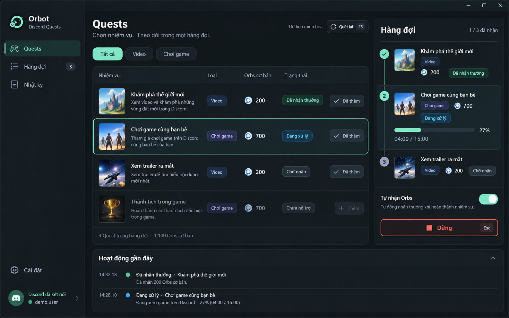
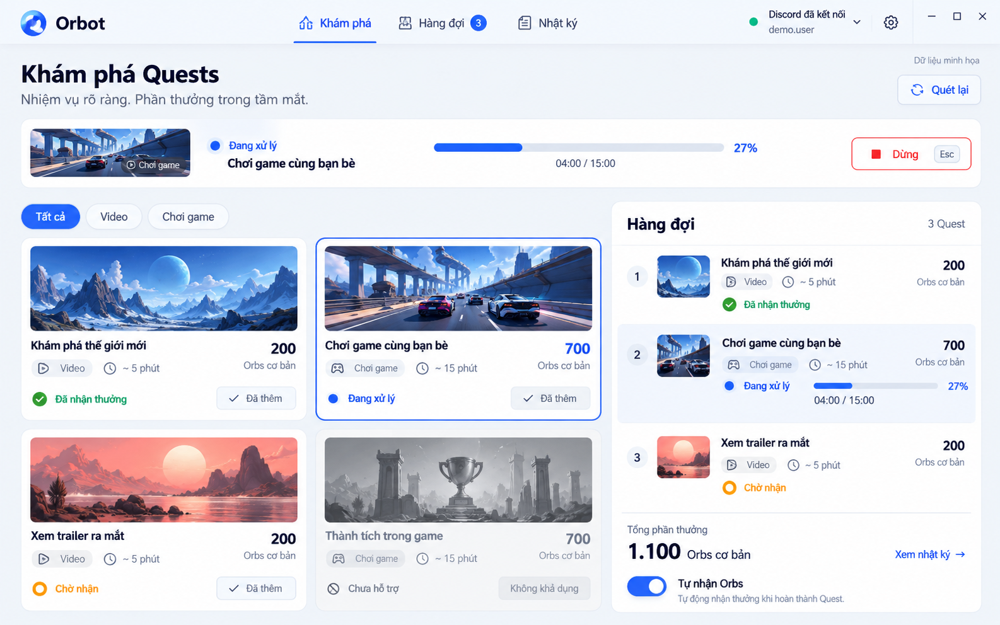
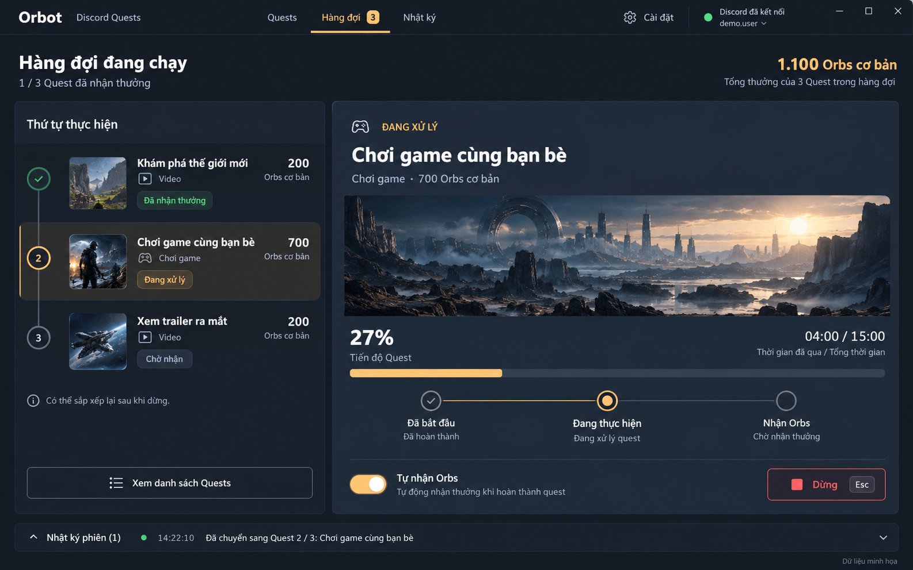

# Orbot: 3 concept UI

Tài liệu concept được tạo trước khi triển khai FE. Người dùng đã chọn **03. Focus Flow**, nay là giao diện của Orbot 0.2.0. Ba ảnh và prompt được giữ để tham khảo.

Template: UI Screenshot System (ui-screenshot-system), cases 17, 2, 4, từ gpt-image-2-style-library. Tạo ảnh bằng built-in image_gen.

Đã đọc README.md, DESIGN.md, orbot/app.py, orbot/demo.py và xem [giao diện cũ](../legacy-ui.png). UI/UX Pro Max trả về RPA / Automation Dashboard; áp dụng bố cục vận hành, trạng thái rõ ràng, tránh mô hình landing page.

## 01. Orbit Command

Tối graphite, nhấn mint. Danh sách Quest và hàng đợi đồng thời. Ưu tiên thao tác nhanh, kiểm soát trạng thái. Hướng đề xuất cho desktop utility hiện tại.

## 02. Quest Studio

Sáng trắng và cobalt. Điều hướng ngang, thẻ Quest có minh họa, hàng đợi bên phải. Dễ nhìn và dễ làm quen. Minh họa là đề xuất tài nguyên mới khi triển khai.

## 03. Focus Flow

Slate tối, nhấn amber. Hàng đợi bên trái, Quest đang chạy làm trọng tâm. Phù hợp theo dõi phiên chạy dài.

## Quy tắc chung

- Luồng: kết nối Discord, chọn Quest, hàng đợi tuần tự, tiến độ, nhận thưởng, dừng, nhật ký.
- Orbs cơ bản không phải số dư hoặc cam kết nhận thưởng.
- Nút Dừng luôn dễ thấy khi chạy. Sắp xếp/xóa chỉ khi đã dừng.
- Cổng và cấu hình ít dùng đưa vào kết nối/cài đặt; nhật ký gọn.
- Mỗi ảnh có nhãn Dữ liệu minh họa, dùng cùng dữ liệu: 3 Quest, 1.100 Orbs cơ bản, Quest thứ hai đang chạy 27%.

## Nhận xét sau khi xem ảnh

Cả ba ảnh giữ được chức năng cốt lõi, hàng đợi ba mục, nút Dừng và trạng thái tự nhận Orbs. Lựa chọn cuối cùng của người dùng là Focus Flow. [Ảnh giao diện đã triển khai](../../images/focus-flow.png).

Lưu ý khi triển khai: ảnh Quest Studio tự thêm thời lượng khoảng 5 phút cho Video; đây không phải dữ liệu từ engine. Luôn lấy thời lượng thật từ cấu hình Quest. Một số mô tả phụ trong Orbit Command là chữ minh họa do mô hình tạo. Các thumbnail/banner là tài nguyên concept, không phải hình lấy từ Discord. PROMPTS.md là bộ prompt đã dùng; cần đối chiếu model dữ liệu thật khi viết giao diện.

Đây là ảnh concept, chưa phải giao diện chạy được. Chữ/số trong ảnh có thể sai; PROMPTS.md chứa nội dung chuẩn. Chưa kiểm thử responsive, bàn phím hoặc đo tương phản.

